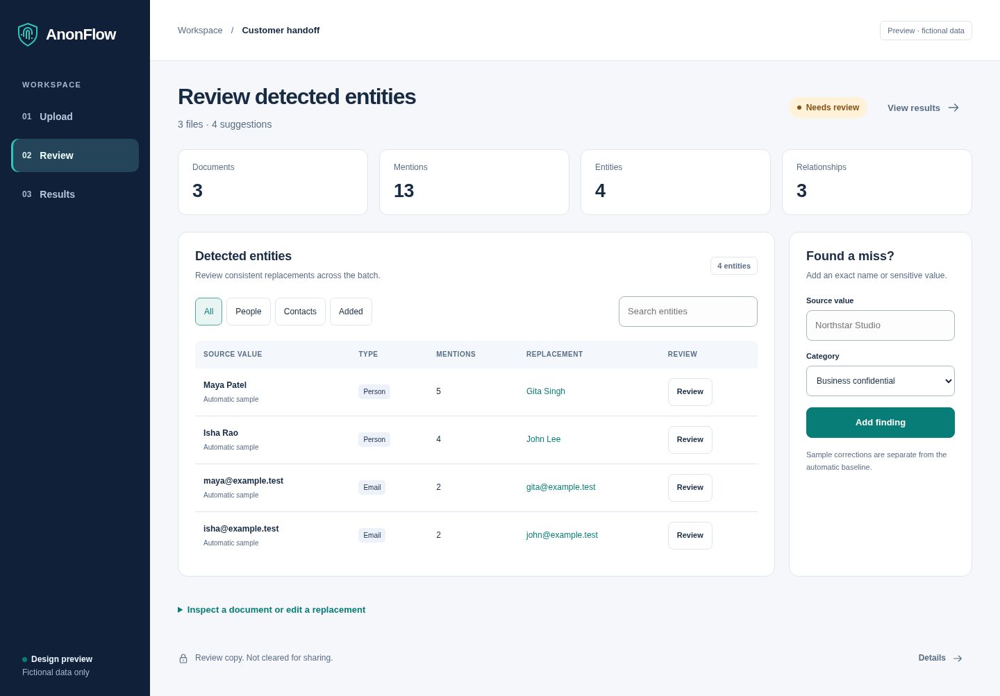

# Workbench design preview

This self-contained mockup keeps the earlier AnonFlow workbench's navigation
and review components while shortening labels and explanatory copy. Open
`index.html` in a browser or serve this directory with a static HTTP server.
It needs no dependencies, authentication, fonts, or external network requests.

All data is fictional. The preview does not run uploads, detection, extraction,
or verification. It is a design proposal separate from the live web app.

## Components retained

| View | Controls and information |
| --- | --- |
| Upload | Three-file sample, loading state, reset |
| Review | Batch counts, entity register, category filters, search, aliases, keep-original decisions, exact-value corrections |
| Documents | File selector, original/copy comparison, structured JSON/CSV output, highlighted relationship evidence |
| Relationships | People and organization nodes, typed directed claims, original/copy labels, zoom/fit, keyboard selection, source evidence, pending/accepted/rejected sample decisions |
| Evaluation | Automatic baseline, reviewed precision/recall, category and document counts, missed labels, correction shortcut, missing-label state, coverage checks |

The layout returns to the earlier navy sidebar and table-led review screen.
**Upload → Review → Results** remains the workflow. Results keeps **Documents,
Relationships, and Evaluation** as separate keyboard-accessible tabs. Detailed
limitations use disclosure panels; the review-copy boundary remains visible.

## Try the full sample

1. Search or filter the entity register. Select **Review** on a row to inspect
   its source and edit the replacement. **Confirm change** or **Keep original**
   records a decision across all exact matching sample mentions.
2. Open **Results → Relationships**. Select a claim or node, review its evidence,
   change the sample claim decision, or open the supporting document and lines.
   **Review copy** labels reflect confirmed replacements.
3. Open **Evaluation**. The fixed sample labels contain 15 spans: 13 automatic
   entity spans and two business-confidential `Northstar Studio` spans. The
   illustrative baseline is 100% precision and 87% recall. Reviewed scores use
   only confirmed replacements; kept or pending spans remain misses.
4. **Add correction** brings the missed company value into the register.
   Confirming it applies both occurrences. An existing partial or misclassified
   manual finding is corrected to the reference value/category and requires
   confirmation again. Manual findings also have an editable category.
5. Clear **Use sample labels** to show the unmeasured state. Corrections and
   exclusions never change the automatic sample baseline.
6. After all entity decisions, **Download sample** requires acknowledgment.
   It produces JSON containing fictional text, entity and relationship
   decisions, and explicit `verified: false` / `clearedForSharing: false` flags.
   Claim acceptance and review completion never authorize sharing.

The relationship fixtures use explicit mail headers, account-owner fields,
and an `employer` field. Mere co-occurrence does not create an edge. Sample
choices stay in memory and reset on reload or **Upload → Reset sample**.
Replacement strings render as text, including HTML-like content. JSON and CSV
values are escaped during serialization; email aliases use the `.test` domain.

## Responsive and accessible behavior

Desktop uses the register beside the correction form and the graph beside its
evidence panel. Tablet and phone layouts stack these panels. Wide tables scroll
inside their own containers. Result tabs support arrows/Home/End; graph nodes
support arrows, Enter, and Space. Active controls retain focus after updates,
evidence navigation focuses its locator, and dialogs support Escape.

Independent GPT-6.1 Sol QA passed 15 screen/tab/viewport combinations at 320px,
390px, and 1440px, plus graph evidence, decisions, score arithmetic, corrections,
category changes, safe structured downloads, filters, keyboard focus, and reset.
No external requests or browser errors occurred in those checks.

## Scope

Scores describe agreement with fixed fictional labels, rather than measured
detector performance. PDF/image pixels, metadata, digital signatures, and Office
hidden content explicitly show **Not evaluated**. Real reference uploads,
media-region editing, recorded identity merge/split/conflict operations, and
production export remain part of the existing application's backend workflows;
this static preview does not execute them.
